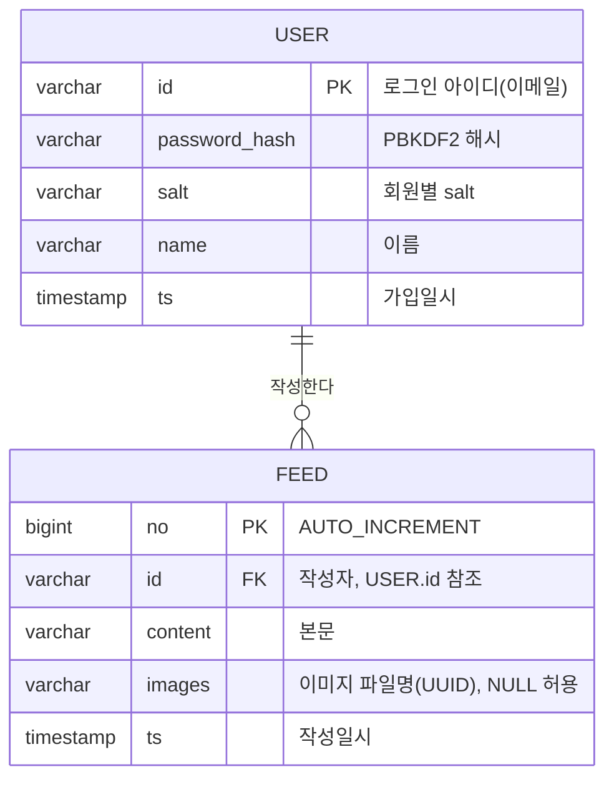

# mysns

> JSP / Servlet + 순수 JDBC로 구현한 미니 SNS 서비스

프레임워크 없이 `DataSource`, `PreparedStatement`, `HttpSession`만으로 웹 애플리케이션의 동작 원리를 직접 구현해 본 학습 프로젝트입니다. 회원가입·로그인·탈퇴와 텍스트/이미지 피드 작성·조회 기능을 제공합니다.

**기술 스택** — Java 17 · Jakarta Servlet 4.0 (javax) · Apache Tomcat 9 · MariaDB 11 / MySQL 8 (InnoDB) · commons-fileupload 1.3

---

## 프로젝트 개요

**어떤 서비스인가**
로그인한 사용자가 짧은 글과 사진 한 장을 올리고, 전체 피드를 최신순으로 함께 보는 형태의 소규모 소셜 네트워크입니다.

**주요 타겟**
서버 사이드 웹 개발의 기초 — 요청/응답 흐름, 세션 기반 인증, 커넥션 풀, SQL 최적화 — 를 프레임워크의 추상화 없이 이해하고자 하는 학습자.

**핵심 비즈니스 로직**

| 기능 | 흐름 |
|---|---|
| 회원가입 | 입력값 검증 → 아이디 중복 검사 → salt 생성 → PBKDF2 해시 → 저장 |
| 로그인 | 아이디 조회 → 해시 비교(상수 시간) → 세션 재발급 → 세션에 아이디 저장 |
| 피드 작성 | 세션에서 작성자 확정 → 이미지 검증·저장(UUID 파일명) → 피드 저장 |
| 피드 조회 | 최신순 페이지네이션 조회 → HTML 이스케이프 후 렌더링 |
| 회원 탈퇴 | 세션 본인 확인 → 비밀번호 재확인 → 삭제(피드는 FK CASCADE로 함께 정리) |

---

## 아키텍처

기존 구조는 JSP가 DAO를 직접 호출하고, DAO 하나가 커넥션 관리·SQL 실행·결과 매핑·비즈니스 규칙을 모두 담당하는 2계층이었습니다. 책임에 따라 아래와 같이 분리했습니다.

```
 JSP (View)
   │  화면 렌더링과 요청 파라미터 수집만 담당
   ▼
 Service          UserService · FeedService
   │  도메인 규칙: 입력 검증, 중복 검사, 비밀번호 검증, 저장 순서
   ▼
 Repository       UserRepository · FeedRepository   ← 인터페이스 (DIP)
   │
   ▼
 JdbcRepository   JdbcUserRepository · JdbcFeedRepository
   │  SQL 실행과 자원 관리만 담당
   ▼
 ConnectionPool → JNDI DataSource (Tomcat)
```

```
src/main/java
├── domain/       User, Feed                      불변 객체 + Builder
├── exceptions/   DataAccessException, DuplicateUserException,
│                 UserNotFoundException, InvalidCredentialsException,
│                 ValidationException
├── repository/   UserRepository, FeedRepository  (인터페이스)
│                 JdbcUserRepository, JdbcFeedRepository
├── service/      UserService, FeedService
├── util/         ConnectionPool, PasswordEncoder,
│                 FileStorageService, HtmlEscaper
└── tools/        SeedDataGenerator               시드 데이터 생성기
```

**적용한 설계 원칙**

- **SRP** — 한 클래스가 SQL 실행과 비즈니스 규칙을 동시에 갖지 않도록 Repository와 Service를 분리했습니다.
- **DIP** — Service는 `UserRepository` 인터페이스에만 의존합니다. 덕분에 DB 없이 인메모리 Fake 구현으로 서비스 로직을 검증할 수 있고, 훗날 JPA로 교체해도 Service 코드는 그대로입니다.
- **Builder 패턴** — `User`/`Feed`는 생성자 인자가 모두 `String`이라 순서를 바꿔 넣어도 컴파일러가 잡아주지 못했습니다. Builder로 각 값에 이름을 붙였습니다.
- **Facade** — `FeedService.publish()`가 "이미지 검증 → 저장 → 파일명으로 피드 생성 → DB 저장"을 한 호출로 감싸, 호출부가 순서를 몰라도 되게 했습니다.

---

## 주요 개선 사항

### 보안

| 항목 | 기존 | 개선 |
|---|---|---|
| 비밀번호 저장 | 평문 저장 후 `equals` 비교 | PBKDF2-HMAC-SHA256, 회원별 salt, 12만 회 반복, 상수 시간 비교 |
| 회원 탈퇴 | 요청 파라미터의 아이디를 그대로 삭제 — **누구나 남의 계정 삭제 가능** | 세션 본인만, 비밀번호 재확인 후 삭제 |
| 피드 작성자 | 폼의 텍스트 입력값을 작성자로 사용 — **타인 사칭 가능** | 세션에서만 작성자 확정, 폼에서 입력칸 제거 |
| 게시글 출력 | 사용자 입력을 HTML에 그대로 연결 — **저장형 XSS** | `HtmlEscaper`로 전량 이스케이프, 세션 쿠키 `HttpOnly` |
| 파일 업로드 | 원본 파일명을 그대로 경로에 사용 — **경로 조작** | UUID 파일명 + 확장자 화이트리스트 + 경로 재검증 + 용량 상한 |
| 로그인 세션 | 로그인 전 세션 ID 그대로 사용 | 인증 성공 시 세션 재발급(**세션 고정 공격** 방어) |
| 비밀번호 확인 | `signup.html`의 `ps2`를 서버에서 검사하지 않음 | 서버에서 일치 검증 |
| 오류 화면 | 예외 발생 시 스택 트레이스 노출 | 로그에만 상세 기록, 화면에는 일반 문구 |

### 안정성 · 성능

| 항목 | 기존 | 개선 |
|---|---|---|
| 자원 해제 | `finally`에서 수동 `close()` | `try-with-resources` 전면 적용 |
| NPE 방어 | `images`가 null이면 호출부에서 터짐 | `Optional<String>`으로 노출 |
| 예외 처리 | `login()`이 `0/1/2` 매직 넘버 반환 | 의미가 분명한 예외 타입 + `web.xml` 전역 error-page |
| 스레드 안전성 | 동기화 없는 지연 초기화 | `volatile` + double-checked locking |
| 조회 쿼리 | `SELECT *`, 전체 행 조회 | 명시적 컬럼, `LIMIT/OFFSET` 페이지네이션 |
| 인덱스 | 없음 (매 요청 풀 스캔 + filesort) | `idx_feed_ts`, `idx_user_ts`, `idx_feed_id_ts` |
| 참조 무결성 | 제약 없음 (고아 피드 발생 가능) | `feed.id → user.id` FK, `ON DELETE CASCADE` |
| 문자셋 | `utf8` (3바이트, 이모지 저장 실패) | `utf8mb4` |

---

## 데이터베이스 구조

전체 ERD·인덱스 설계·정규화 분석은 **[docs/ERD.md](docs/ERD.md)** 에 정리했습니다.



---

## 나의 역할

이 프로젝트에서 백엔드 로직과 DB 스키마를 모두 직접 설계하고 구현했습니다. 특히 아래 결정들을 중점적으로 고민했습니다.

**왜 프레임워크를 쓰지 않았는가**
Spring이나 MyBatis가 대신 처리해 주는 커넥션 관리, 예외 변환, 결과 매핑을 직접 손으로 작성해 보는 것이 이 프로젝트의 목적이었습니다. 그래서 리팩토링에서도 프레임워크를 도입하는 대신, 계층 분리와 자원 관리만 프로덕션 수준으로 끌어올리는 방향을 택했습니다. 그 과정에서 "프레임워크가 실제로 무엇을 대신해 주고 있었는지"를 체감할 수 있었습니다.

**저장소를 인터페이스로 분리한 이유**
처음에는 DAO 클래스 하나면 충분하다고 생각했지만, 서비스 로직을 검증하려면 매번 MySQL이 떠 있어야 한다는 점이 걸렸습니다. `UserRepository`를 인터페이스로 두자 인메모리 Fake 구현체를 주입해 DB 없이 회원가입·로그인·탈퇴 규칙을 전부 검증할 수 있게 되었습니다. 테스트 용이성이 곧 설계를 개선하는 압력이 된다는 것을 실감한 지점입니다.

**실패를 어떻게 표현할 것인가**
기존 `login()`은 `0`(성공), `1`(아이디 없음), `2`(비밀번호 불일치)를 반환했습니다. 호출부가 이 대응표를 외워야 하고, `code == 1`을 `code == 2`로 잘못 써도 컴파일러가 잡아주지 못합니다. 실패를 예외 타입으로 바꾸자 이런 실수가 구조적으로 불가능해졌습니다. 다만 예외 메시지에는 아이디 존재 여부를 드러내지 않도록 해, 공격자가 가입된 아이디를 수집(user enumeration)하지 못하게 했습니다.

**비밀번호를 외부 라이브러리 없이 다루기**
BCrypt를 쓰면 간단했지만, 의존성을 늘리지 않고 JDK 표준만으로 안전한 해시가 가능한지 확인하고 싶었습니다. `javax.crypto`의 `PBKDF2WithHmacSHA256`에 회원별 salt와 12만 회 반복을 적용해 해결했습니다.

---

## 공부한 내역

**JDBC와 자원 생명주기**
`ResultSet`은 자신을 만든 `Statement`에, `Statement`는 `Connection`에 생명주기가 묶여 있습니다. 이 종속 관계를 이해하지 못해 실제로 버그를 겪었고(아래 Troubleshooting), `try-with-resources`가 선언의 **역순**으로 자원을 닫는다는 점이 왜 중요한지 알게 되었습니다.

**JVM 메모리 모델과 동시성**
톰캣은 요청마다 스레드를 배정하므로, 정적 필드의 지연 초기화는 동기화 없이는 안전하지 않습니다. `volatile`이 보장하는 가시성과 happens-before 관계, 그리고 `volatile` 없는 double-checked locking이 왜 "절반만 초기화된 객체"를 노출할 수 있는지를 학습했습니다. 매 호출마다 `synchronized`를 거는 방식과의 성능 트레이드오프도 함께 비교했습니다.

**트랜잭션 격리 수준**
MySQL InnoDB의 기본 격리 수준인 `REPEATABLE READ`가 Dirty Read와 Non-repeatable Read를 막아 주지만, 표준상 Phantom Read는 허용된다는 점(InnoDB는 갭 락으로 상당 부분 방지)을 정리했습니다. `READ COMMITTED`로 낮추면 락 범위가 좁아져 동시성은 올라가지만 같은 트랜잭션 안에서 읽은 값이 달라질 수 있다는 트레이드오프도 이해했습니다.

**경쟁 조건(Race Condition)과 최종 방어선**
회원가입에서 "존재 여부 확인 → INSERT" 사이에 다른 요청이 같은 아이디를 선점할 수 있는 TOCTOU 문제를 알게 되었습니다. 애플리케이션 검사는 사용자 친화적 메시지를 위한 것이고, **최종 방어선은 DB의 PK/UNIQUE 제약**이라는 원칙을 배워, 제약 위반 예외를 도메인 예외로 번역하는 방식으로 처리했습니다.

**인덱스와 실행 계획**
`ORDER BY` 대상 컬럼에 인덱스가 없으면 풀 스캔 후 filesort가 발생합니다. 또 복합 인덱스 `(id, ts)`는 선행 컬럼이 등치 조건에 쓰일 때만 제 역할을 하며, 순서를 뒤집으면 사실상 무용지물이 된다는 점을 학습했습니다.

**웹 보안 기초**
저장형 XSS, 경로 조작, 세션 고정, user enumeration 등 이 프로젝트에서 실제로 발견한 취약점들을 통해, "사용자 입력은 신뢰하지 않는다"와 "권한은 클라이언트가 아니라 서버가 판단한다"는 두 원칙을 코드 수준에서 익혔습니다.

---

## Troubleshooting: 닫힌 커서를 붙잡고 있었던 이야기

### 증상

메인 피드 화면을 만들던 중, 분명히 쿼리는 정상적으로 실행되는데 결과를 화면에 뿌리는 순간 예외가 터졌습니다.

```
java.sql.SQLException: Operation not allowed after ResultSet closed
```

당시 `main.jsp`는 이런 모양이었습니다. JSP 안에서 DB를 직접 열고, 그 자리에서 화면까지 그리는 구조였습니다.

```java
String sql = "SELECT * FROM feed ORDER BY ts DESC";

Connection conn = ConnectionPool.get();
PreparedStatement stmt = conn.prepareStatement(sql);
ResultSet rs = stmt.executeQuery();

stmt.close();
conn.close();        // ← 여기서 정리했으니 깔끔하다고 생각했다

while (rs.next()) {  // ← 그런데 여기서 터진다
    ...
}
```

### 처음의 잘못된 접근

처음엔 "커넥션을 빨리 반납할수록 좋다"고만 생각했습니다. 커넥션 풀은 유한한 자원이니 다 쓰면 즉시 닫아야 한다고 배웠고, 쿼리를 실행한 직후가 그 시점이라고 판단한 것입니다. `executeQuery()`가 반환한 `rs`에 이미 **모든 데이터가 담겨 있다**고 착각한 것이 문제의 출발점이었습니다.

`rs`를 미리 다른 변수에 담아 보기도 하고, `close()` 순서를 `conn` → `stmt`로 바꿔 보기도 했지만 증상은 그대로였습니다. 순서의 문제가 아니라 **구조의 문제**였기 때문입니다.

### 원인 파악

`ResultSet`은 데이터의 스냅샷이 아니라 **서버 측 커서에 대한 핸들**입니다. `rs.next()`를 호출할 때마다 커넥션을 통해 다음 행을 가져옵니다. 즉 세 객체의 생명주기가 이렇게 묶여 있습니다.

```
Connection  ──소유──▶  Statement  ──소유──▶  ResultSet
```

상위 객체를 닫으면 하위 객체는 그 즉시 무효화됩니다. 커넥션을 닫아 놓고 `rs.next()`를 부르는 것은, 이미 끊어 버린 전화선에 대고 "다음 내용 알려 줘"라고 말하는 것과 같았습니다.

더 근본적인 문제는 **JSP 한 파일 안에서 "데이터를 읽는 일"과 "화면을 그리는 일"이 뒤섞여 있었다**는 점입니다. 두 관심사가 같은 스코프에 있으니, 자원 정리 코드가 어디에 놓이든 렌더링 도중에 끼어들 여지가 항상 존재했습니다.

### 해결

문제를 "언제 닫을 것인가"가 아니라 **"커넥션 스코프와 데이터 사용 스코프를 어떻게 분리할 것인가"** 로 다시 정의했습니다. 그래서 세운 원칙이 이것입니다.

> **커넥션이 열려 있는 스코프 안에서 `ResultSet`을 자바 컬렉션으로 완전히 물질화(materialize)한 뒤 반환한다.**

`JdbcFeedRepository`가 이 원칙을 구현합니다.

```java
public List<Feed> findAllOrderByCreatedAtDesc(int offset, int limit) {
    String sql = "SELECT no, id, content, images, ts FROM feed ORDER BY ts DESC LIMIT ? OFFSET ?";

    try (Connection conn = ConnectionPool.get();
         PreparedStatement stmt = conn.prepareStatement(sql)) {

        stmt.setInt(1, limit);
        stmt.setInt(2, offset);

        List<Feed> feeds = new ArrayList<>();
        try (ResultSet rs = stmt.executeQuery()) {
            while (rs.next()) {         // 커넥션이 살아있는 동안 전부 읽어서
                feeds.add(mapRow(rs));  // 순수 자바 객체로 옮겨 담는다
            }
        }
        return feeds;                   // 이 시점에 커넥션은 안전하게 반납된다
    } catch (SQLException | NamingException e) {
        throw new DataAccessException("피드 목록 조회에 실패했습니다.", e);
    }
}
```

이제 JSP는 이미 메모리에 올라온 `List<Feed>`만 다루므로, 커넥션이 언제 닫히든 렌더링에 영향을 주지 않습니다.

```java
List<Feed> feeds = new FeedService().getRecentFeeds();  // 끝. 자원 걱정 없음
```

`try-with-resources`가 선언의 역순(`rs` → `stmt` → `conn`)으로 닫아 준다는 것을 이해하고 나서야, 왜 이 순서가 자연스러운지도 납득할 수 있었습니다. 소유 관계의 말단부터 정리해야 안전하기 때문입니다.

### 배운 것

이 문제가 남긴 교훈은 자원 해제 문법 그 자체보다도, **계층을 나누면 특정 종류의 버그가 "고쳐지는" 게 아니라 "생길 수 없게 된다"** 는 점이었습니다. 데이터 조회를 Repository로 밀어 넣은 뒤로는 같은 실수를 하고 싶어도 할 수가 없습니다. 커넥션이라는 자원이 애초에 그 계층 밖으로 나오지 않기 때문입니다.

이후 모든 조회 메서드에 같은 원칙을 일관되게 적용했고, `JdbcUserRepository`도 동일한 형태를 따릅니다.

---

## Troubleshooting 2: 실행 환경에서 드러난 한글 인코딩 문제 (진행 중)

리팩토링을 마치고 **실제로 서버를 띄워 화면을 열어보는 과정에서** 정적 분석으로는 잡히지 않던 문제들이 연달아 드러났다. 코드가 아니라 데이터와 환경 설정 쪽 문제였고, 화면을 직접 보지 않았다면 끝까지 몰랐을 종류였다.

### 증상

가입자 목록 화면에서 회원 이름이 이렇게 깨져 나왔다.

```
+---------------+---------------+
| id            | name          |
+---------------+---------------+
| jeong@abc.com | ???           |
| kim@abc.com   | ?¹€??œ??¼ |
| kwon@abc.com  | ?¶Œ?œ¨    |
+---------------+---------------+
```

반면 같은 화면의 **피드 본문 한글은 멀쩡했다.** 같은 DB, 같은 화면인데 어떤 값은 깨지고 어떤 값은 멀쩡하다는 점이 실마리였다.

### 첫 번째 착각과 그것을 버린 과정

처음에는 "폰트가 없나?" 싶었다. Windows에 한글 폰트가 빠졌을 리 없는데도 눈에 보이는 게 글자 모양이라 그쪽부터 의심하게 됐다. 하지만 폰트 문제라면 피드 본문도 같이 깨져야 하는데 그렇지 않았다. **표시(rendering)의 문제가 아니라 데이터의 문제**라는 뜻이었다.

그래서 화면 인코딩에 좌우되지 않는 근거를 확보하기로 했다. 콘솔이 어떻게 그리든 바이트는 거짓말을 하지 않는다.

```sql
SELECT name, HEX(name) FROM user;
```

### 원인 분석

정상적인 `김시민` 의 UTF-8 바이트는 `EAB980EC8B9CEBAFBC` 다. 그런데 화면에 찍힌 `?¹€??œ??¼` 를 역산해 보니 정확히 맞아떨어지는 시나리오가 있었다.

```
원본     김시민
UTF-8    EA B9 80 EC 8B 9C EB AF BC
         ↓ 이 바이트열을 cp1252(Windows-1252)로 잘못 해석
문자열   ê  ¹  €  ì  ‹  œ  ë  ¯  ¼     →  "김시민"
         ↓ 그 상태로 다시 UTF-8 저장  (이중 인코딩)
DB 저장  김시민
         ↓ CP949 콘솔이 표현 못하는 문자를 ? 로 대체
화면     ?¹€??œ??¼
```

문자 개수(9자)와 살아남은 문자(`¹` `€` `œ` `¼`)의 위치가 모두 일치했다. 가설이 확정되는 순간이었다.

그리고 `jeong@abc.com` 의 `???` 는 **성격이 다른 문제**였다. 이건 이중 인코딩이 아니라 한글 세 글자가 `?` 문자 그 자체로 저장된 것이다. 표현할 수 없는 문자를 만난 DB가 `?` 로 치환해 버린 결과라, 원본이 DB 어디에도 남아있지 않다. **되돌릴 수 없는 데이터 소실**이다.

피드 본문이 멀쩡했던 이유도 이제 설명이 됐다. 그 데이터는 SQL 파일이 아니라 **웹 애플리케이션의 JDBC 커넥션을 통해** 들어갔기 때문이다. 즉 유입 경로마다 문자셋이 달랐던 것이다.

### 뒤이어 드러난 진짜 원인

DB 서버 설정을 확인하자 근본 원인이 보였다.

```
character_set_client     = euckr
character_set_connection = euckr
character_set_results    = euckr
character_set_server     = latin1
collation_server         = latin1_swedish_ci
```

클라이언트 기본값이 `euckr`, 서버 기본값이 `latin1` 이었다. 그런데 내가 작성한 `schema.sql` 은 DB와 테이블을 명시적으로 `utf8mb4` 로 만들고, `data.sql` 첫 줄에 `SET NAMES utf8mb4` 도 넣어 두었다. **그렇다면 서버 기본값과 무관하게 정상이어야 하는데 왜 깨졌을까?**

여기서 더 근본적인 실수가 드러났다.

```sql
SHOW CREATE TABLE user;
-- CREATE TABLE `user` (
--   `id` varchar(128) NOT NULL,
--   `password` varchar(32) DEFAULT NULL,   ← 평문 비밀번호! 리팩토링 이전 스키마
--   ...
-- ) ENGINE=InnoDB DEFAULT CHARSET=utf8mb3
```

새 스키마가 전혀 적용되지 않았다. 원인은 내가 쓴 `CREATE DATABASE IF NOT EXISTS` / `CREATE TABLE IF NOT EXISTS` 였다. **이미 같은 이름의 DB가 있으면 아무것도 바꾸지 않고 조용히 넘어간다.** 그 결과 옛 스키마가 그대로 남았고, 이어서 실행된 `data.sql` 은 이렇게 실패했다.

```
ERROR 1054 (42S22): Unknown column 'password_hash' in 'INSERT INTO'
```

터미널을 스쳐 지나가 놓치기 쉬운 메시지였다. 겉으로는 데이터가 들어있으니 정상처럼 보이지만, 실은 **예전에 넣어둔 옛 데이터가 그대로 남아있었을 뿐**이었다. "조용한 실패(silent failure)가 시끄러운 실패보다 훨씬 위험하다"는 걸 체감한 지점이다.

덤으로 환경 관련 문제도 두 가지 더 나왔다. 설치된 DB가 MySQL이 아니라 **MariaDB 11.3** 이어서 JDBC 드라이버를 MariaDB Connector/J로 바꿔야 했고, PowerShell은 `<` 입력 리디렉션을 지원하지 않아 `mysql -e "SOURCE ..."` 방식으로 바꿔야 했다.

### 시도한 해결 방법

| 문제 | 대응 |
|---|---|
| SQL 파일 로딩 시 문자셋 | `schema.sql` / `data.sql` 첫 줄에 `SET NAMES utf8mb4;` 추가해 클라이언트 설정과 무관하게 파일이 스스로 문자셋을 선언하도록 함 |
| `IF NOT EXISTS` 로 인한 조용한 실패 | `schema.sql` 상단에 경고 블록 추가, 업그레이드 시 `DROP DATABASE` 를 선행하도록 문서화 |
| JDBC 커넥션 문자셋 | `context.xml` 의 URL에 `characterEncoding=UTF-8&useUnicode=true` 명시 |
| 서버 기본 문자셋 | `my.ini` 에 `character-set-server=utf8mb4` 지정 |
| 드라이버 불일치 | MariaDB Connector/J + `org.mariadb.jdbc.Driver` 로 전환 |
| 커넥션 풀 안정성 | `testOnBorrow` + `validationQuery` 추가해 DB 재시작 후 죽은 커넥션이 남지 않도록 함 |

### 현재 상태 — 해결방안 모색 중

격리된 테스트 환경(MariaDB + 재구축한 DB)에서는 위 조치로 한글과 이모지가 모두 정상 저장·출력되는 것을 확인했다. 다만 **로컬 개발 환경에 동일하게 적용해 검증하는 작업은 아직 진행 중**이다. 남은 과제는 다음과 같다.

- `my.ini` 문자셋 변경 후 기존 DB를 재구축하고, 애플리케이션 전 구간에서 한글 입출력을 재검증
- 유입 경로(SQL 파일 / JDBC / 폼 입력)별로 문자셋이 일관되게 UTF-8로 유지되는지 확인
- 이미 `?` 로 소실된 데이터는 복구가 불가능하므로, 애초에 그런 저장이 일어나지 않도록 막을 방법 검토
  (커넥션 레벨 검증, 혹은 저장 전 인코딩 가능 여부 확인)
- 근본적으로는 환경 설정에 의존하는 구조 자체가 취약하다고 판단해, 향후 Docker 등으로 DB 환경을 코드화해 재현 가능하게 만드는 방안을 검토 중

이번 경험에서 가장 크게 남은 것은, **"코드가 컴파일되고 단위 테스트를 통과한다고 해서 동작하는 것은 아니다"** 라는 사실이다. 문자 인코딩처럼 여러 계층(파일 → 클라이언트 → 커넥션 → 서버 → 컬럼 → 출력)을 통과하는 값은, 한 계층만 어긋나도 조용히 손상된다. 그리고 그 손상은 대체로 **실제로 띄워서 눈으로 봐야만** 발견된다.

---

## 실행 방법

> Eclipse + Tomcat 9 + MySQL 환경에서 처음 띄우신다면 **[docs/RUNBOOK.md](docs/RUNBOOK.md)** 에 단계별 절차와 자주 막히는 지점(드라이버 배치, JNDI 바인딩 오류, 한글 깨짐 등)을 정리해 두었습니다.
> 실제 구동 후 수행한 테스트 결과는 **[docs/TEST_REPORT.md](docs/TEST_REPORT.md)** 에 있습니다.

### 1. 데이터베이스 준비

```bash
mysql -u root -p < src/main/webapp/SQL/schema.sql
```

### 2. 시드 데이터 (선택)

비밀번호를 해시로 저장하므로 SQL에 비밀번호를 직접 적을 수 없습니다. 생성기를 실행해 로그인 가능한 INSERT 문을 만듭니다.

```bash
javac -encoding UTF-8 -d build/classes \
      src/main/java/util/PasswordEncoder.java \
      src/main/java/tools/SeedDataGenerator.java
java -Dstdout.encoding=UTF-8 -cp build/classes tools.SeedDataGenerator > seed.sql
mysql -u root -p < seed.sql
```

미리 생성해 둔 `SQL/data.sql`을 그대로 써도 됩니다. 계정은 `kim@abc.com` 외 2개이며 비밀번호는 모두 `test1234!` 입니다.

### 3. 커넥션 풀 설정

`src/main/webapp/META-INF/context.xml`의 계정 정보를 환경에 맞게 수정합니다.

> **참고** — MySQL Connector/J 8부터 `com.mysql.jdbc.Driver`는 폐기되었습니다. 드라이버 8.x를 쓴다면 `com.mysql.cj.jdbc.Driver`로 바꾸고, JAR을 Tomcat의 `lib/` 폴더에 두어야 합니다(웹앱의 `WEB-INF/lib`가 아닙니다).

### 4. 배포

Tomcat 9에 배포한 뒤 `http://localhost:8080/mysns/` 로 접속합니다.

---

## 알려진 한계 및 다음 단계

- **[진행 중] 로컬 환경 한글 인코딩 검증** — 격리된 테스트 환경에서는 해결을 확인했으나, 로컬 개발 환경에 적용해 재검증하는 작업이 남아 있습니다. 상세 경위는 위 [Troubleshooting 2](#troubleshooting-2-실행-환경에서-드러난-한글-인코딩-문제-진행-중) 참고.
- **DB 환경이 코드로 관리되지 않음** — 문자셋·엔진 같은 서버 설정이 각자의 로컬 설정에 의존해, 같은 SQL을 실행해도 환경마다 결과가 달라집니다. Docker Compose 등으로 DB 환경을 고정하는 방안을 검토 중입니다.
- **JSP 스크립트릿 구조** — 여전히 뷰가 요청 파라미터 수집과 흐름 제어를 겸하고 있습니다. `Servlet` 계층을 도입해 JSP를 순수 렌더링 전용으로 만들고, 출력은 JSTL `<c:out>`으로 옮기는 것이 다음 단계입니다.
- **CSRF 방어 없음** — 폼에 CSRF 토큰이 없어, 로그인한 사용자가 악성 사이트를 방문하면 의도치 않은 글쓰기/탈퇴 요청이 전송될 수 있습니다.
- **자동화된 테스트 부재** — Repository 인터페이스로 테스트 가능한 구조는 만들었지만 JUnit 테스트 코드는 아직 없습니다.
- **팔로우/좋아요 기능 없음** — 설계안은 `docs/ERD.md`에 정리해 두었습니다.
- **이미지 파일 정리 없음** — 피드가 삭제되어도 업로드된 이미지 파일은 디스크에 남습니다.
- **로깅** — `ServletContext.log()`에 의존하고 있어, SLF4J 등 표준 로깅 파사드 도입이 필요합니다.
