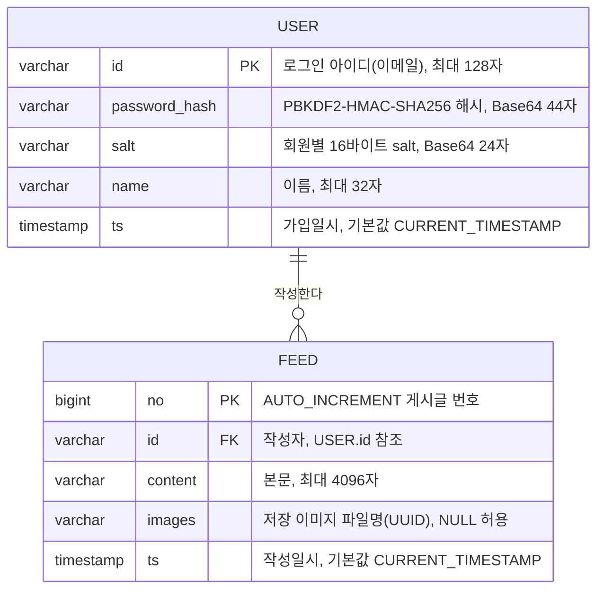
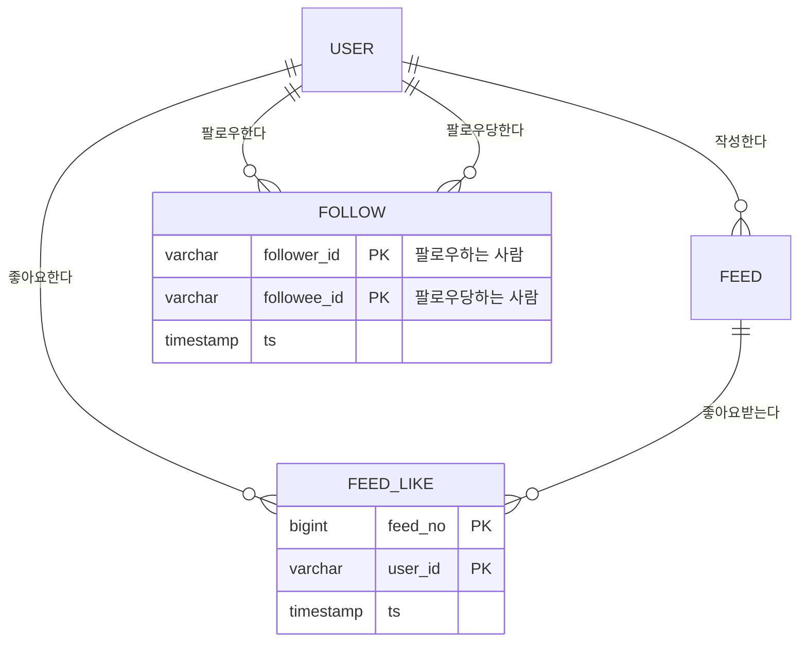

# mysns 데이터베이스 구조 (ERD)

## 엔티티 관계도

## 관계 상세

| 관계 | 카디널리티 | 설명 |
|---|---|---|
| USER → FEED | 1 : N | 회원 한 명은 피드를 0개 이상 작성할 수 있고, 각 피드의 작성자는 정확히 한 명이다. |

- **기본키(PK)**: `user.id`(자연키, 이메일), `feed.no`(대리키, AUTO_INCREMENT)
- **외래키(FK)**: `feed.id → user.id`
  - `ON DELETE CASCADE`: 회원 탈퇴 시 그 회원의 피드도 함께 삭제되어 고아 레코드가 남지 않는다.
  - `ON UPDATE CASCADE`: 아이디 변경 시 피드의 작성자 참조가 함께 갱신된다.

`feed.no`에 대리키를 쓴 이유는, 작성자와 시각의 조합이 유일하다는 보장이 없고(같은 사람이 같은 초에 두 번 쓸 수 있음) 복합 자연키를 FK로 끌고 다니는 비용이 크기 때문이다.

## 인덱스 설계

| 테이블 | 인덱스 | 대상 쿼리 | 효과 |
|---|---|---|---|
| user | `PRIMARY (id)` | 로그인, 중복 검사 | 아이디 단건 조회를 O(log n)으로 처리 |
| user | `idx_user_ts (ts)` | `ORDER BY ts DESC` (가입자 목록) | 정렬용 filesort 제거 |
| feed | `PRIMARY (no)` | 단건 조회 | — |
| feed | `idx_feed_ts (ts)` | `ORDER BY ts DESC` (메인 피드) | 풀 스캔 + filesort 제거 |
| feed | `idx_feed_id_ts (id, ts)` | `WHERE id = ? ORDER BY ts DESC` (마이피드) | 선행 컬럼으로 범위를 좁힌 뒤 정렬 순서를 그대로 활용 |

복합 인덱스 `(id, ts)`의 컬럼 순서가 중요하다. 등치 조건에 쓰이는 `id`가 앞에 와야 인덱스로 범위를 좁힐 수 있고, 그 안에서 `ts`가 이미 정렬되어 있으므로 `ORDER BY`에 추가 정렬 비용이 들지 않는다. 순서를 `(ts, id)`로 두면 이 쿼리에는 거의 쓸모가 없다.

## 정규화 상태

두 테이블 모두 **제3정규형(3NF)**을 만족한다.

- 1NF: 모든 컬럼이 원자값이며 반복 그룹이 없다.
- 2NF: 기본키가 단일 컬럼이므로 부분 함수 종속이 존재할 수 없다.
- 3NF: 비키 컬럼 사이에 이행적 종속이 없다(예: `name`이 `password_hash`를 결정하지 않는다).

현재 규모에서는 추가 정규화의 실익이 없으며, 오히려 조인 비용만 늘어난다. 트래픽이 커질 경우의 반정규화 후보는 `schema.sql` 하단 주석에 정리해 두었다.

## 확장 시 설계 (팔로우 / 좋아요)

현재 프로젝트에는 팔로우·좋아요 기능이 없다. 추가한다면 N:M 관계를 아래처럼 교차 테이블로 풀어내는 것이 자연스럽다.

`FEED_LIKE`에 `(feed_no, user_id)` 복합 기본키를 두면 "한 사람이 같은 글에 좋아요를 두 번 누르는" 중복이 DB 수준에서 차단된다. 애플리케이션에서 `SELECT` 후 `INSERT`로 검사하면 동시 요청 시 경쟁 조건이 생기지만, 복합 PK는 그 경쟁을 DB가 최종적으로 막아준다.
